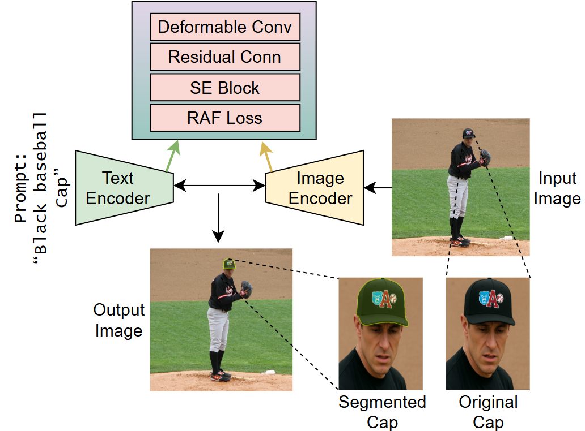
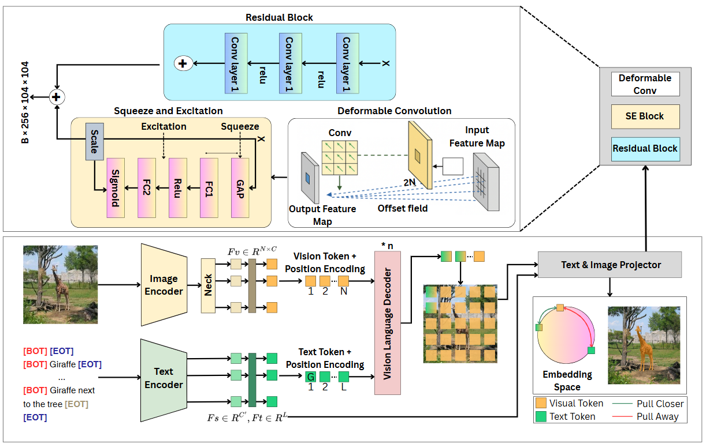
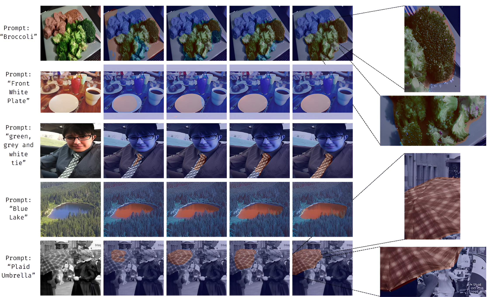
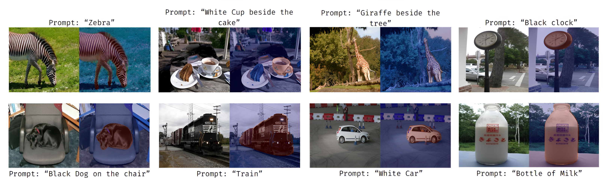
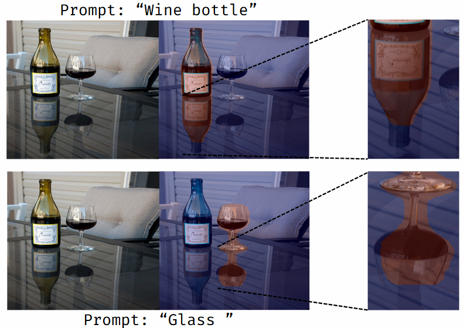

<div align="center">

# SegVLM: Deformable Attentive Visual Enhancement for Referring Image Segmentation Using Vision-Language Model

[Alaa S. Dalaq](https://scholar.google.com/citations?user=0qOTVbcAAAAJ&hl=en)<sup>1</sup> and [Muzammil Behzad](https://scholar.google.com.pk/citations?user=nrZ-GGcAAAAJ&hl=en)<sup>1,2,*</sup>

<sup>1</sup>King Fahd University of Petroleum and Minerals, Saudi Arabia <br> &nbsp;&nbsp; <sup>2</sup>SDAIA-KFUPM Joint Research Center for Artificial Intelligence

\*Corresponding email: muzammil.behzad@kfupm.edu.sa

[](https://github.com/BRAIN-Lab-AI/SegVLM)
[](https://arxiv.org/abs/2505.19242)
[](https://www.python.org/)
[](#)
[](https://opensource.org/licenses/MIT)

</div>

> **SegVLM** (Deformable Attentive Visual Enhancement for Referring Image Segmentation Using Vision-Language Model) segments the object described by a natural-language expression. It strengthens visual features before vision-language fusion using deformable convolutions, Squeeze-and-Excitation (SE) recalibration, and a residual connection, and is trained with a novel **Referring-Aware Fusion (RAF) loss**.

Referring image segmentation requires a model to jointly understand an image and a natural-language expression, then produce a pixel-level mask of the referred object. Strong CLIP-based models such as CRIS perform well on RefCOCO-style benchmarks, but struggle on datasets like **PhraseCut**, where expressions are longer and more compositional and object distinctions are finer.

**SegVLM** extends CRIS with a lightweight visual enhancement block placed in the visual projection pathway, so visual features carry context-aware, boundary-sensitive cues before they meet the text-derived kernels. Combined with the RAF loss, which balances region overlap, hard pixels, and class imbalance, SegVLM achieves **53.87% mIoU on PhraseCut** (+10.3 over the CRIS baseline) with only **149.74M parameters** and roughly **35 ms per image**.



*Given an image and a referring expression such as "Black baseball cap", SegVLM produces a precise mask of the described object, even when it occupies only a small region of the scene.
The text and image encoders are enhanced with deformable convolutions, an SE block, a residual connection, and the RAF loss.*
## Overview of SegVLM



SegVLM builds on four key components:

1. **Deformable Convolutions**: Learn spatial offsets so the receptive field adapts to irregular object shapes and boundaries.
2. **Squeeze-and-Excitation (SE) Block**: Recalibrates feature channels, emphasizing discriminative visual cues and suppressing irrelevant ones before fusion.
3. **Residual Connection**: Adds the enhanced features back to the input, preserving low-level spatial detail and stabilizing training.
4. **Referring-Aware Fusion (RAF) Loss**: Combines BCE, Focal, and Adaptive Dice losses to handle class imbalance, focus on hard pixels, and sharpen mask boundaries.

## Quick Start

### Step 1: Clone the Repository

```bash
git clone https://github.com/BRAIN-Lab-AI/SegVLM.git
cd SegVLM
```

### Step 2: Set Up Environment

```bash
python -m venv venv
source venv/bin/activate  # On Windows: venv\Scripts\activate

pip install -r requirements.txt
```

### Step 3: Download Pretrained CLIP Weights

Download the CLIP ResNet weights and place them in `pretrain/`:

- [RN50.pt](https://openaipublic.azureedge.net/clip/models/afeb0e10fbe2be4ba0d9eec1c1a9a8d50c93bbc5ae4dd8a2bf9cf73c2e36d8b8/RN50.pt)
- [RN101.pt](https://openaipublic.azureedge.net/clip/models/8fa8567bab74a42d41c5915025a8e4538c3bdbe8804a470a72f30b0d94fab599/RN101.pt)

### Step 4: Prepare Datasets

SegVLM is evaluated on four referring segmentation benchmarks:

| Dataset | Images | Expressions | Role in SegVLM |
|---|---|---|---|
| **PhraseCut** | 77K | 345K | Main benchmark |
| **RefCOCO** | 20K | 142K | Generalization |
| **RefCOCO+** | 20K | 142K | Generalization (no location words) |
| **RefCOCOg** | 27K | 105K | Generalization (longer expressions) |

Each dataset goes through the same two-stage pipeline:

```
Raw annotations ──► data_process.py ──► masks + JSON ──► folder2lmdb.py ──► LMDB
```

**Example (RefCOCO):**

```bash
# 1. Generate masks and annotation files
python tools/data_process.py --data_root datasets --output_dir datasets \
       --dataset refcoco --split unc --generate_mask

# 2. Convert every split to LMDB
for SPLIT in train val testA testB; do
  python tools/folder2lmdb.py -j datasets/anns/refcoco/${SPLIT}.json \
         -i datasets/images/train2014/ -m datasets/masks/refcoco -o datasets/lmdb/refcoco
done
```

📦 For download links, Refcoco family datasets, and preparing the datasets structure, see **[[tools/prepare_datasets.md](tools/prepare_datasets.md](https://github.com/DerrickWang005/CRIS.pytorch/blob/master/tools/prepare_datasets.md))**.
## Launch SegVLM

#### Training

```bash
python -u train.py --config config/refcoco/segvlm_r101.yaml
```

#### Evaluation

```bash
python -u test.py --config config/refcoco/segvlm_r101.yaml
```

#### Latency Benchmark

```bash
python tools/latency.py --config config/refcoco/segvlm_r101.yaml
```

Configs are provided for `refcoco`, `refcoco+`, `refcocog_u`, and `refcocog_g`, with ResNet-50 and ResNet-101 backbones.

## Project Structure

```
├── config/                  # Configs for each dataset and backbone
├── engine/
│   └── engine.py            # Training and evaluation loops
├── model/
│   ├── clip.py              # CLIP backbone
│   ├── layers.py            # Fusion, decoder, and enhancement layers
│   └── segmenter.py         # SegVLM model
├── pretrain/                # CLIP weights (download separately)
├── static/images/           # README figures
├── tools/
│   ├── data_process.py      # Dataset preprocessing
│   ├── folder2lmdb.py       # LMDB conversion
│   ├── latency.py           # Speed benchmark
│   └── refer.py             # REFER API
├── utils/                   # Config, dataset, tokenizer, misc
├── LICENSE
├── README.md
├── test.py
└── train.py
```

## Results
We evaluate SegVLM on **PhraseCut**, our main benchmark, using mean Intersection-over-Union (mIoU) and precision at several IoU thresholds (Prec@50 to Prec@90).
Higher thresholds are stricter: they only count a prediction as correct when its mask closely matches the ground truth, so they reflect boundary quality.
We then test generalization on RefCOCO, RefCOCO+, and RefCOCOg, and show qualitative examples across diverse scenes.
### Comparison with State of the Art on PhraseCut

| Model | mIoU (%) | Prec@50 | Prec@70 | Prec@90 |
|---|---|---|---|---|
| GROUNDHOG | 54.50 | – | – | – |
| MDETR (EfficientNet-B3) | 53.70 | 57.50 | 39.90 | 11.90 |
| MDETR (ResNet-101) | 53.10 | 56.10 | 38.90 | 11.90 |
| CLIPSeg (PC, D=128) | 48.20 | – | – | – |
| CRIS (baseline) | 43.57 | 45.10 | 25.10 | 4.10 |
| HULANet | 41.30 | 42.90 | 27.80 | 5.90 |
| Mask R-CNN (Top) | 39.40 | 40.90 | 25.80 | 4.80 |
| ViTSeg (PC) | 38.90 | – | – | – |
| Mask R-CNN (Self-trained) | 36.20 | 37.20 | 22.90 | 4.10 |
| RMI | 21.10 | 22.00 | 11.60 | 1.50 |
| MattNet | 20.20 | 19.70 | 13.50 | 3.00 |
| **SegVLM (Ours)** | **53.87** | **58.23** | **40.81** | **12.64** |

SegVLM achieves **53.87% mIoU**, a **+10.30** improvement over the CRIS baseline, and surpasses both MDETR variants. It also achieves the **highest precision at every reported threshold**. GROUNDHOG reports a slightly higher mIoU but does not report precision scores, so its localization quality cannot be fully compared.

### Ablation Study on PhraseCut

| Variant | mIoU | Prec@50 | Prec@60 | Prec@70 | Prec@80 | Prec@90 |
|---|---|---|---|---|---|---|
| Baseline (CRIS) | 43.57 | 45.10 | 35.40 | 25.10 | 14.20 | 4.10 |
| + RAF Loss | 48.25 | 50.70 | 39.80 | 29.60 | 17.10 | 6.50 |
| + Deformable + SE | 51.34 | 54.30 | 42.70 | 33.20 | 20.20 | 8.20 |
| **+ Residual (SegVLM)** | **53.87** | **58.23** | **45.10** | **40.81** | **22.80** | **12.64** |


SegVLM transfers well beyond PhraseCut, reaching **74.00% mIoU** on RefCOCO Test A. It stays competitive on RefCOCO+, which removes location words and relies on appearance alone, and on RefCOCOg, which has longer descriptive expressions. Inference time stays stable at about **35 ms per image** across all datasets, so the enhancement modules add very little computational overhead.

### Generalization to RefCOCO Benchmarks

| Dataset | Split | mIoU | P@50 | P@70 | P@90 | Inference (ms) |
|---|---|---|---|---|---|---|
| RefCOCO | Val | 71.81 | 84.00 | 73.66 | 19.03 | 34.75 ± 7.60 |
| RefCOCO | Test A | 74.00 | 87.33 | 77.71 | 17.41 | 34.65 ± 7.00 |
| RefCOCO | Test B | 68.62 | 78.59 | 67.11 | 23.26 | 34.57 ± 8.80 |
| RefCOCO+ | Val | 63.40 | 73.42 | 64.00 | 15.18 | 34.42 ± 9.57 |
| RefCOCO+ | Test A | 68.17 | 80.30 | 71.36 | 14.65 | 34.55 ± 8.39 |
| RefCOCO+ | Test B | 54.97 | 61.67 | 50.66 | 16.04 | 34.23 ± 6.90 |
| RefCOCOg | Val | 59.16 | 68.74 | 57.82 | 14.97 | 35.37 ± 11.79 |


### Qualitative Results
We present visual examples showing how SegVLM performs across diverse scenes, how each component improves the masks, and an emergent ability to segment reflections.


*SegVLM segments the referred object across diverse scenes and prompts, from single words ("Zebra", "Train") to relational expressions ("White cup beside the cake", "Black dog on the chair").*


*From left to right: input image, baseline, + RAF loss, + deformable convolutions with SE block, + residual connection (SegVLM). Each enhancement improves localization and boundary quality.*




*An emergent capability: SegVLM also segments object reflections, such as the wine bottle and glass on the table.*
## License

This project is licensed under the MIT License. See the [LICENSE](LICENSE) file for details.

## Citation

If you find SegVLM useful for your research, please cite our paper:

```bibtex
@article{dalaq2025segvlm,
  title   = {Deformable Attentive Visual Enhancement for Referring Segmentation
             Using Vision-Language Model},
  author  = {Dalaq, Alaa S. and Behzad, Muzammil},
  journal = {arXiv preprint arXiv:2505.19242},
  year    = {2025},
  url     = {https://arxiv.org/abs/2505.19242}
}
```

## Acknowledgements

We thank King Fahd University of Petroleum and Minerals and the SDAIA-KFUPM JRC for Artificial Intelligence for supporting this research. 
## Contact

For questions or collaborations, please contact:

- Alaa S. Dalaq: [g202320570@kfupm.edu.sa]
- Muzammil Behzad: muzammil.behzad@kfupm.edu.sa

---

⭐ If you find SegVLM useful, please consider starring the repository! ⭐
